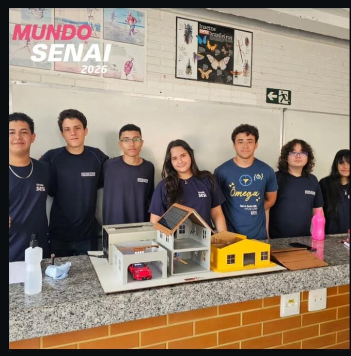
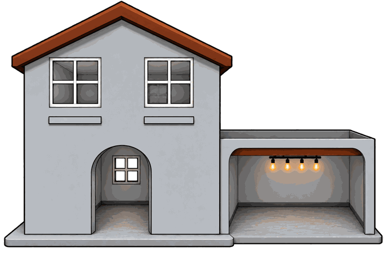

# Registros do Mundo SENAI

Equipe reunida atrás da bancada com as maquetes da casa inteligente e da garagem, no Mundo SENAI 2026.

Apresentei a maquete e expliquei o LED da casa, o varal automático e o sistema de ventilação.

Ilustração da apresentação que mostra o sobrado e a garagem da maquete.

Ilustração da apresentação que mostra a casa amarela do projeto.
